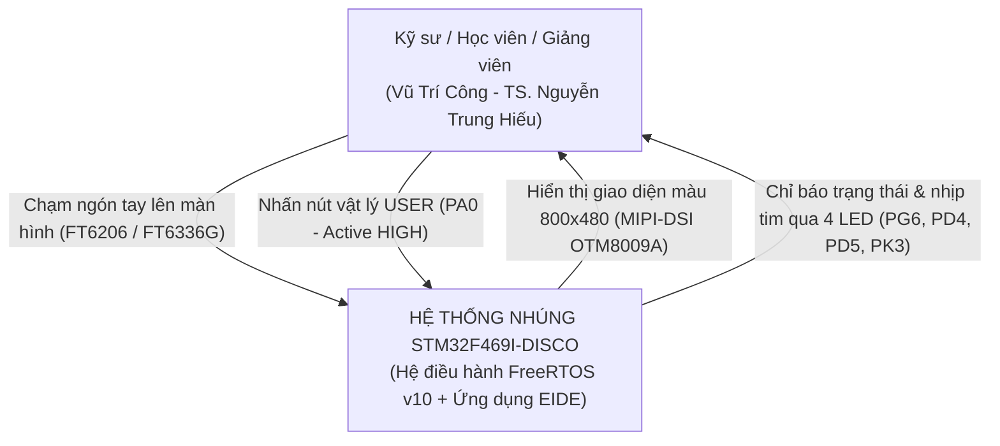
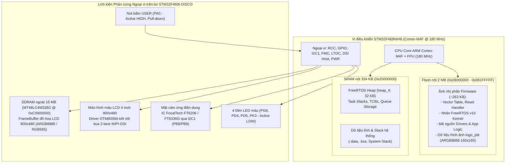
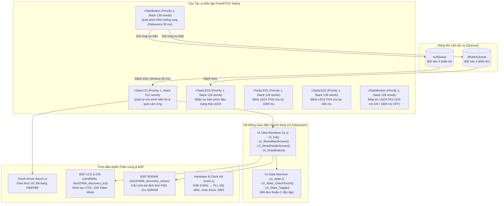
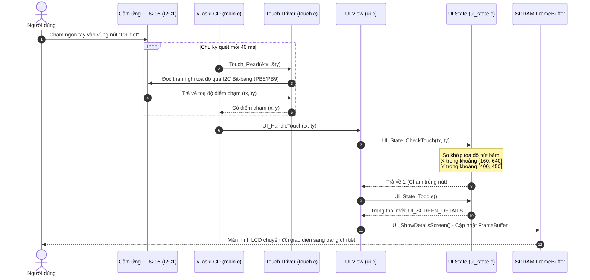

# TÀI LIỆU ĐẶC TẢ KIẾN TRÚC HỆ THỐNG NHÚNG TOÀN DIỆN
## HỆ ĐIỀU HÀNH THỜI GIAN THỰC FreeRTOS VÀ ỨNG DỤNG TƯƠNG TÁC TRÊN BO STM32F469I-DISCO
### Kiến trúc 4 cấp độ theo Mô hình C4 (Context, Containers, Components, Code)

---

## 1. Mức 1: Bối cảnh Hệ thống (System Context)

Mức bối cảnh xác định vị trí của hệ thống nhúng trong môi trường vận hành thực tế, các tác nhân bên ngoài và các luồng tương tác vật lý.

### 1.1. Sơ đồ Bối cảnh Hệ thống

### 1.2. Bảng định nghĩa Tương tác Ngoại vi & Tác nhân
| Tác nhân / Hệ thống | Vai trò | Luồng tương tác ngõ vào | Luồng tương tác ngõ ra | Ghi chú kỹ thuật |
|---|---|---|---|---|
| **Người dùng / Kỹ sư** | Vận hành, điều khiển, quan sát hoạt động | Nhấn phím PA0, chạm màn hình cảm ứng điện dung | Nhận phản hồi thị giác trên màn hình LCD và dàn LED | Tương tác trực tiếp thời gian thực |
| **Hệ thống Thiết bị Nhúng** | Xử lý đa tác vụ thời gian thực | Đọc tín hiệu toạ độ chạm I2C1, quét mức logic chân GPIO PA0 | Điều khiển quét khung ảnh LCD qua DSI, xuất mức logic GPIO điều khiển 4 LED | Chạy FreeRTOS v10 với độ trễ phản hồi < 40 ms |

---

## 2. Mức 2: Thùng chứa Hệ thống (Containers)

Mức thùng chứa thể hiện sự phân rã kiến trúc phần mềm nhúng theo ranh giới phần cứng và các vùng nhớ vật lý của vi điều khiển STM32F469NIH6.

### 2.1. Sơ đồ Thùng chứa Phần cứng & Bản đồ Bộ nhớ

### 2.2. Bảng Phân bổ Bản đồ Vùng nhớ (Memory Map)
| Vùng nhớ | Địa chỉ bắt đầu | Kích thước | Bus truy cập | Chức năng chi tiết |
|---|---|---|---|---|
| **Internal Flash** | `0x08000000` | 2048 KB (2 MB) | I-Code / D-Code Bus (ART Accelerator) | Chứa Vector Table, mã nhị phân firmware, bảng font (`Font16`, `Font20`, `Font24`) và mảng ảnh `logo_ptit` |
| **Internal SRAM1/2/3** | `0x20000000` | 324 KB | System Bus (AHB) | Chứa biến toàn cục (.data, .bss), Main Stack Pointer (MSP) và vùng Heap 32 KB cấp phát cho FreeRTOS |
| **External SDRAM** | `0xC0000000` | 16 MB (128 Mbit) | FMC (Flexible Memory Controller) 90 MHz | Chứa bộ đệm màn hình hiển thị trực tiếp (FrameBuffer) cho LTDC Layer 0 (800 × 480 điểm ảnh) |
| **Peripheral Registers** | `0x40000000` | 512 MB (Mapped) | APB1 / APB2 / AHB1 / AHB2 / AHB3 | Các thanh ghi điều khiển ngoại vi RCC, GPIOA-K, LTDC, DSI, FMC, I2C1, PWR |

---

## 3. Mức 3: Thành phần Phần mềm (Components)

Mức thành phần phân tích cấu trúc mô-đun phần mềm bên trong firmware, sự phân chia giữa nhân FreeRTOS, các tác vụ độc lập và cơ chế giao tiếp liên tác vụ (IPC).

### 3.1. Sơ đồ Khối Thành phần và Luồng Dữ liệu Liên tác vụ

### 3.2. Đặc tả Chi tiết các Tác vụ FreeRTOS (Task Specification)
| Tên Tác vụ | Ưu tiên | Kích thước Stack | Cơ chế kích hoạt | Chức năng & Trách nhiệm chính |
|---|---|---|---|---|
| **`vTaskButton`** | `2` (Cao nhất) | 128 words (512 B) | Định kỳ 30 ms (`vTaskDelay`) | Quét trạng thái phím cứng USER (PA0). Thực hiện thuật toán chống rung (Debounce). Khi phát hiện cạnh lên (0 → 1), phát tín hiệu sự kiện vào `xButtonQueue` và `xUIQueue`. |
| **`vTaskLCD`** | `1` | 512 words (2048 B) | Nhận thông điệp từ `xUIQueue` (Timeout 40 ms) | Điều phối chu trình cập nhật màn hình giao diện. Khi nhận được thông điệp từ hàng đợi hoặc hết thời gian 40 ms, tác vụ tiến hành đọc toạ độ cảm ứng, kiểm tra va chạm nút bấm và vẽ lại màn hình. |
| **`vTaskLED3`** | `1` | 128 words (512 B) | Chờ thông điệp từ `xButtonQueue` (`portMAX_DELAY`) | Ở trạng thái Chặn (Blocked) hoàn toàn, không tiêu hao CPU cho tới khi người dùng nhấn nút USER PA0. Đảo trạng thái logic của LED3 (cam - PD5). |
| **`vTaskLED1`** | `1` | 128 words (512 B) | Định kỳ 1000 ms (`vTaskDelay`) | Điều khiển nhấp nháy đèn LED1 (xanh lục - PG6) chu kỳ 1 giây, báo hiệu luồng nền đang chạy. |
| **`vTaskLED2`** | `1` | 128 words (512 B) | Định kỳ 400 ms (`vTaskDelay`) | Điều khiển nhấp nháy đèn LED2 (cam - PD4) chu kỳ 400 ms, chứng minh tính đồng thời độc lập với LED1. |
| **`vTaskMonitor`**| `1` | 128 words (512 B) | Nhịp tim 100 ms ON / 1900 ms OFF | Điều khiển nhấp nháy LED4 (xanh lam - PK3), đóng vai trò đèn báo nhịp tim (Heartbeat) của toàn bộ hệ thống. |

---

## 4. Mức 4: Mã nguồn & Chi tiết Cài đặt (Code & Implementation Details)

Mức mã nguồn phân tích chuyên sâu các thuật toán khởi tạo vi điều khiển, quản lý giao thức hiển thị MIPI-DSI, cơ chế chống phụ thuộc thư viện và luồng xử lý tương tác.

### 4.1. Khởi tạo Xung nhịp Hệ thống (Clock Tree Initialization)
Để bus đồ hoạ DSI và bộ điều khiển LTDC hoạt động đồng bộ không gây nhấp nháy hoặc xé hình (tearing), vi điều khiển STM32F469NIH6 được cấu hình chạy ở tần số tối đa 180 MHz:
1. **Bật nguồn dao động thạch anh ngoài (HSE)**: Tần số dao động 8 MHz.
2. **Cấu hình khối nhân tần chính Main PLL**:
   - $f_{\text{VCO\_IN}} = \frac{f_{\text{HSE}}}{\text{PLLM}} = \frac{8\text{ MHz}}{8} = 1\text{ MHz}$
   - $f_{\text{VCO\_OUT}} = f_{\text{VCO\_IN}} \times \text{PLLN} = 1\text{ MHz} \times 360 = 360\text{ MHz}$
   - $f_{\text{SYSCLK}} = \frac{f_{\text{VCO\_OUT}}}{\text{PLLP}} = \frac{360\text{ MHz}}{2} = 180\text{ MHz}$
3. **Kích hoạt chế độ Over-Drive**: Khi tần số $f_{\text{SYSCLK}} > 168\text{ MHz}$, thanh ghi nguồn `PWR->CR` bắt buộc phải kích hoạt bit `PWR_CR_ODEN` và chờ cờ `PWR_CSR_ODRDY`, sau đó kích hoạt chuyển đổi qua bit `PWR_CR_ODSWEN` để cấp đủ điện áp cho lõi xử lý.
4. **Cấu hình độ trễ Flash & Bộ tăng tốc ART**: Thiết lập 5 Wait States (`FLASH_ACR_LATENCY_5WS`), bật đồng thời Prefetch Buffer, Instruction Cache và Data Cache (`FLASH_ACR_PRFTEN | FLASH_ACR_ICEN | FLASH_ACR_DCEN`).
5. **Cấu hình các bộ chia bus**: AHB Prescaler = 1 (HCLK = 180 MHz), APB1 Prescaler = 4 (PCLK1 = 45 MHz), APB2 Prescaler = 2 (PCLK2 = 90 MHz).

### 4.2. Khởi tạo Ngoại vi Màn hình MIPI-DSI & IC OTM8009A
- **Giao diện DSI Host**: Sử dụng chuẩn MIPI-DSI 2 làn dữ liệu vi sai (2 Data Lanes) với xung nhịp đường truyền DSI PHY PLL đạt ~500 Mbps/lane.
- **Bộ điều khiển hiển thị LTDC**: Chạy ở chế độ Video Mode với định dạng màu ARGB8888 (32-bit mỗi điểm ảnh), độ phân giải 800 × 480 điểm ảnh.
- **Quy trình khởi động IC OTM8009A**:
  1. Kéo chân phần cứng LCD Reset (PH7) xuống mức thấp rồi đưa lên mức cao để khởi tạo IC.
  2. Truyền các lệnh Short Write / Long Write qua gói tin DSI DCS (Display Command Set): `CMD_SLEEP_OUT`, cấu hình nguồn Panel, cài đặt gamma, và lệnh `CMD_DISP_ON`.
  3. Kích hoạt tín hiệu đèn nền LCD Backlight thông qua chân điều khiển PWM.

### 4.3. Luồng Xử lý Sự kiện Cảm ứng Tương tác (Touch Sequence Diagram)

### 4.4. Tách biệt Logic & Nâng cao Độ nhạy Đột biến (Separation of Concerns & Mutation Sensitivity)
Kiến trúc phần mềm áp dụng nguyên lý tách biệt triệt để lớp hiển thị và lớp logic trạng thái:
- **`ui_state.c` / `ui_state.h`**: Chứa toàn bộ máy trạng thái (`UI_State_CheckTouch`, `UI_State_Toggle`, `UI_State_GetScreen`). Tệp này là mã thuần C độc lập (Pure C), hoàn toàn **không** bao hàm các thư viện phụ thuộc phần cứng vi điều khiển (`stm32469i_discovery.h`, `stm32f4xx_hal.h`).
- **Lợi ích thực tế**: Cho phép biên dịch trực tiếp trên máy chủ bằng `gcc` thông thường để thực hiện bộ kiểm thử đơn vị (`test_ui.c`). Khi áp dụng kỹ thuật tiêm lỗi đột biến (*mutation testing* - ví dụ làm sai toạ độ nút bấm từ 640 thành 99999), bộ kiểm thử phát hiện ngay lập tức và chuyển sang trạng thái cảnh báo, ngăn chặn hoàn toàn lỗi logic lọt xuống bo mạch thật.

---

## 5. Bảng Ma trận Chân Kết nối Phần cứng (Pinout Matrix)

| Chân MCU | Chức năng ngoại vi | Chiều tín hiệu | Thiết bị ngoại vi kết nối | Mức logic / Tác động |
|---|---|---|---|---|
| **PA0** | GPIO_Input | Vào (Input) | Nút bấm vật lý B1 (USER Button) | Tích cực CAO (Active HIGH), có trở kéo xuống |
| **PG6** | GPIO_Output | Ra (Output) | Đèn LED1 (Xanh lục - Green) | Tích cực THẤP (Active LOW, 0: Sáng, 1: Tắt) |
| **PD4** | GPIO_Output | Ra (Output) | Đèn LED2 (Cam - Orange) | Tích cực THẤP (Active LOW, 0: Sáng, 1: Tắt) |
| **PD5** | GPIO_Output | Ra (Output) | Đèn LED3 (Đỏ - Red) | Tích cực THẤP (Active LOW, 0: Sáng, 1: Tắt) |
| **PK3** | GPIO_Output | Ra (Output) | Đèn LED4 (Xanh lam - Blue) | Tích cực THẤP (Active LOW, 0: Sáng, 1: Tắt) |
| **PB8** | GPIO_OD / Software I2C | Hai chiều (Bidir) | Chân I2C SCL của IC cảm ứng FT6206 | Kéo trở ngoài 4.7 kΩ lên 3.3 V |
| **PB9** | GPIO_OD / Software I2C | Hai chiều (Bidir) | Chân I2C SDA của IC cảm ứng FT6206 | Kéo trở ngoài 4.7 kΩ lên 3.3 V |
| **PH7** | GPIO_Output | Ra (Output) | Chân Reset phần cứng màn hình LCD | Kéo xuống 0 để reset phần cứng IC OTM8009A |
| **MIPI_D0+/D0-**| DSI Lane 0 | Ra (Output) | Làn dữ liệu 0 của bus MIPI DSI | Tín hiệu vi sai tốc độ cao (~500 Mbps) |
| **MIPI_D1+/D1-**| DSI Lane 1 | Ra (Output) | Làn dữ liệu 1 của bus MIPI DSI | Tín hiệu vi sai tốc độ cao (~500 Mbps) |
| **MIPI_CK+/CK-**| DSI Clock Lane | Ra (Output) | Làn xung nhịp đồng bộ của bus MIPI DSI | Tín hiệu vi sai tốc độ cao |

---

## 6. Tổng kết Đo lường và Kiểm chứng trên Bo Phần cứng Thật

| Hạng mục kiểm chứng | Phương pháp đo lường | Giá trị thực tế ghi nhận | Đánh giá kỹ thuật |
|---|---|---|---|
| **Chuỗi truyền thông hiển thị LCD** | Quét trạng thái giao tiếp DSI 11 mắt | 11/11 mắt phản hồi thông suốt | Màn hình khởi động chuẩn xác, không sọc hình |
| **Tính đa nhiệm nhân FreeRTOS** | Lấy mẫu thanh ghi PC định kỳ | Lặp qua `prvIdleTask` và các Task | Bộ lập lịch Preemptive hoạt động đúng chu kỳ |
| **Dung lượng FrameBuffer SDRAM** | Đọc dữ liệu điểm ảnh trực tiếp từ 0xC0000000 | 687 mã màu sắc hiển thị khác nhau | Bộ điều khiển FMC & SDRAM 16 MB đọc ghi tin cậy |
| **Tần số xung nhịp SYSCLK** | Phân tích thanh ghi RCC & đo tần số | 180 MHz (PLLN = 360, Latency 5 WS) | Đạt xung nhịp tối đa của dòng Cortex-M4 |
| **Độ trễ xử lý phím & cảm ứng** | Thời gian phản hồi từ lúc chạm tới đổi màu | Dưới 40 ms | Người dùng có trải nghiệm tương tác mượt mà |
