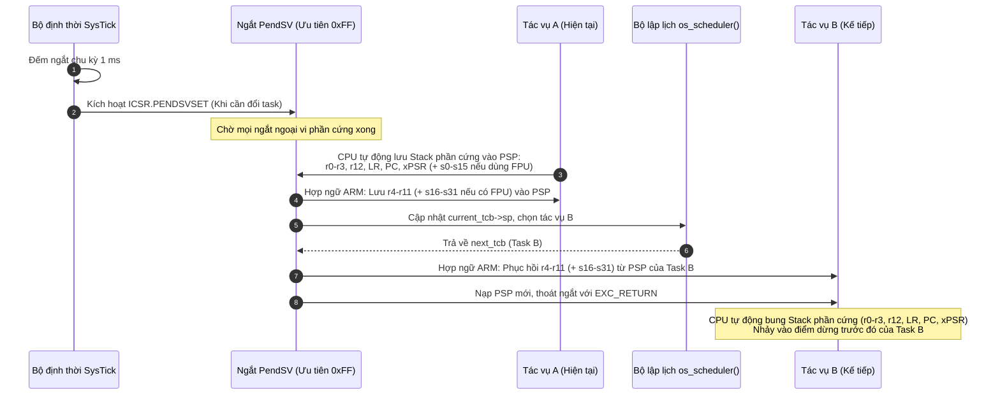
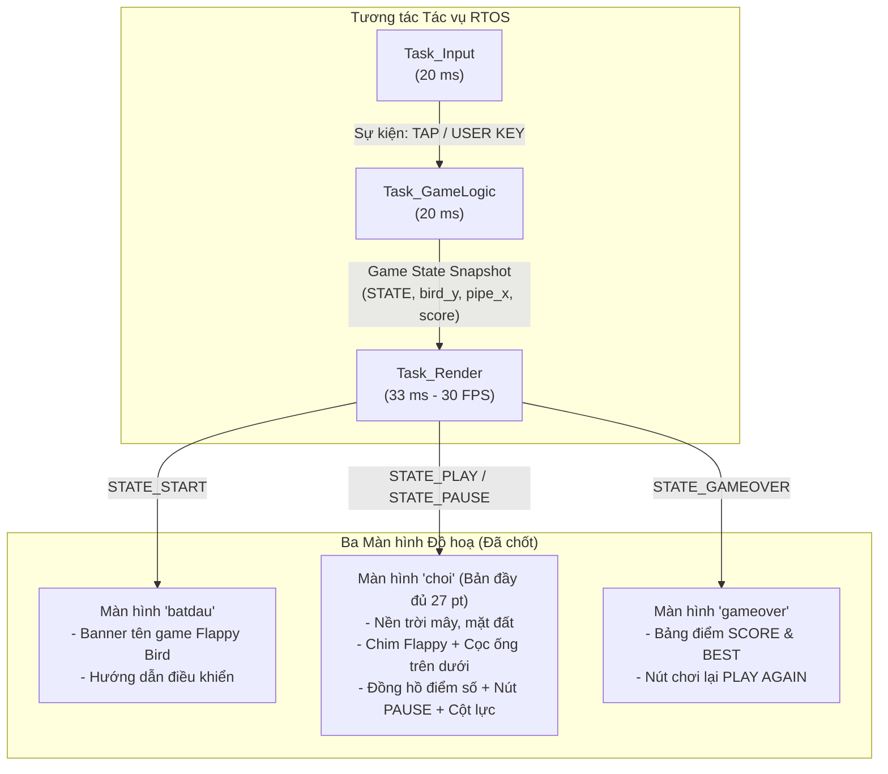

# THIẾT KẾ KIẾN TRÚC NHÂN RTOS & HỆ THỐNG ĐA TÁC VỤ
## Dự án: Game Flappy Bird trên kit STM32F469I-DISCO
### Tài liệu kỹ thuật tiền khả thi trước khi lập trình

---

## 1. Mục tiêu và Nguyên tắc Thiết kế

1. **Tuân thủ đề bài (NFR-01)**: Tự viết nhân RTOS thời gian thực (Preemptive Real-Time Kernel) hỗ trợ ARM Cortex-M4F, hoàn toàn độc lập, không nhúng mã nguồn FreeRTOS.
2. **Deterministic Context Switching**: Đảm bảo chuyển ngữ cảnh nhanh, an toàn, sử dụng cặp đôi ngắt chuẩn của kiến trúc Cortex-M: `SysTick` (nhịp đồng hồ) và `PendSV` (thực thi chuyển ngữ cảnh ở mức ưu tiên thấp nhất).
3. **Xử lý trọn vẹn FPU (Floating Point Unit)**: Lưu và phục hồi chuẩn xác các thanh ghi số thực (s0–s31, FPSCR) trên vi điều khiển STM32F469NIH6 (Cortex-M4F @ 180 MHz) để ngăn chặn hoàn toàn HardFault.
4. **Tách biệt hiển thị và logic**: Một tác vụ chuyên trách duy nhất vẽ FrameBuffer đồ hoạ trên SDRAM 16 MB để loại trừ xung đột bus FMC/LTDC.

---

## 2. Danh sách Tác vụ, Chu kỳ & Kích thước Ngăn xếp (Task Table)

Hệ thống được tổ chức thành 5 tác vụ độc lập chạy đa nhiệm theo mức ưu tiên:

| Tên Tác vụ | Mức ưu tiên (0 = thấp nhất) | Chu kỳ / Kích hoạt | Kích thước Stack (Words / Bytes) | Vai trò & Màn hình hiển thị |
|---|---|---|---|---|
| **`Task_Input`** | `3` (Cao nhất) | Định kỳ **20 ms** (50 Hz) | 256 words (1024 B) | Đọc nút bấm vật lý PA0 (chống rung), quét cảm ứng FT6206 (I2C1). Bắn tín hiệu sự kiện nhảy chim (Tap/Jump). |
| **`Task_GameLogic`**| `2` (Cao) | Định kỳ **20 ms** (50 Hz) | 512 words (2048 B) | Máy trạng thái game (Start / Play / Over). Tính quỹ đạo chim rơi, cọc trôi, kiểm tra va chạm hộp biên (AABB), tính điểm. |
| **`Task_Render`** | `1` (Trung bình) | Định kỳ **33 ms** (~30 FPS) | 1024 words (4096 B) | **Tác vụ duy nhất vẽ màn hình**. Đọc trạng thái game và vẽ tương ứng ra SDRAM FrameBuffer: `batdau`, `choi`, `gameover`. |
| **`Task_Heartbeat`**| `1` (Trung bình) | Định kỳ **500 ms** (2 Hz) | 128 words (512 B) | Đảo trạng thái đèn LED1 (PG6) và LED4 (PK3), chỉ báo nhân RTOS đang chạy lành mạnh. |
| **`Task_Idle`** | `0` (Thấp nhất) | Liên tục khi CPU rảnh | 128 words (512 B) | Chạy lệnh `WFI` (Wait For Interrupt) đưa lõi vào chế độ ngủ tiết kiệm điện năng. |

### Tổng ngân sách bộ nhớ ngăn xếp (SRAM Budget)
- Tổng Stack cho 5 tác vụ: $(256 + 512 + 1024 + 128 + 128) \times 4\text{ B} = 2048\text{ words} = 8192\text{ B} \approx 8\text{ KB}$.
- So sánh với tài nguyên chip: Vi điều khiển STM32F469NIH6 có **324 KB SRAM nội**, dung lượng cho stack nhân RTOS chỉ chiếm **~2,5 %**, đảm bảo an toàn tuyệt đối, không tràn bộ nhớ (No Stack Overflow).

---

## 3. Cơ chế Chuyển ngữ cảnh (Context Switching) trên ARM Cortex-M4F



### 3.1. Phân chia Con trỏ Ngăn xếp
- **MSP (Main Stack Pointer)**: Dùng riêng cho mã khởi tạo hệ thống, nhân hệ điều hành, và các trình phục vụ ngắt (ISR: SysTick, PendSV, I2C, LTDC).
- **PSP (Process Stack Pointer)**: Mỗi tác vụ người dùng sở hữu một vùng nhớ Stack riêng, thanh ghi PSP được trỏ vào đỉnh stack của tác vụ đó khi tác vụ được trao quyền CPU.

### 3.2. Cấu trúc Khung Ngăn xếp (Stack Frame)
Khi một tác vụ bị tạm dừng, ngăn xếp của nó lưu tổng cộng:
1. **Khung phần cứng (Hardware Frame)** - do CPU tự động push:
   - `xPSR`, `PC`, `LR`, `r12`, `r3`, `r2`, `r1`, `r0` (8 từ = 32 bytes).
   - Nếu FPU kích hoạt: thêm `FPSCR`, `s0–s15` (17 từ = 68 bytes).
2. **Khung phần mềm (Software Frame)** - do hàm ngắt PendSV push bằng hợp ngữ:
   - `r4`, `r5`, `r6`, `r7`, `r8`, `r9`, `r10`, `r11` (8 từ = 32 bytes).
   - Nếu FPU kích hoạt: thêm `s16–s31` (16 từ = 64 bytes).

### 3.3. Quy trình Ngắt PendSV & SVC
- **`SVC_Handler` (Supervisor Call)**: Được sử dụng duy nhất 1 lần khi gọi `os_kernel_start()` để chuyển từ Handler Mode sang Thread Mode, nạp ngữ cảnh cho tác vụ đầu tiên mà không cần ngữ cảnh trước đó.
- **`PendSV_Handler`**: Có độ ưu tiên thấp nhất trong NVIC (`NVIC_SetPriority(PendSV_IRQn, 0xFF)`). Nhờ đó, việc đổi ngữ cảnh không bao giờ làm trễ các ngắt ngoại vi thời gian thực quan trọng như nhận I2C từ cảm ứng hoặc quét DSI.

---

## 4. Phân chia Trách nhiệm Vẽ Màn hình & Máy Trạng thái Giao diện

Toàn bộ quyền điều khiển FrameBuffer đồ hoạ (địa chỉ `0xC0000000` trên SDRAM) được giao duy nhất cho **`Task_Render`**.



### Chi tiết hiển thị của từng màn hình:
1. **Màn hình `batdau`**:
   - Được vẽ khi hệ thống ở trạng thái `STATE_START`.
   - Hiển thị tiêu đề Flappy Bird, hộp hướng dẫn chạm màn hình hoặc bấm nút PA0 để bắt đầu chơi.
2. **Màn hình `choi`** (phiên bản chuẩn hóa 27 phần tử, kế thừa từ `game_play`):
   - Được vẽ khi hệ thống ở trạng thái `STATE_PLAY` hoặc `STATE_PAUSE`.
   - Cập nhật thời gian thực toạ độ chim (`bird_body`, `bird_wing`, `bird_eye`, `bird_beak`), cọc ống trên dưới (`pipe1`, `pipe2`), thanh đo xung lực (`hud_pwr_bar`), điểm số hiện tại và điểm kỷ lục.
3. **Màn hình `gameover`**:
   - Được vẽ khi hệ thống ở trạng thái `STATE_GAMEOVER` (va chạm cọc hoặc rơi chạm đất).
   - Hiển thị bảng tổng kết điểm số, huy chương, và nút "PLAY AGAIN" để quay lại trạng thái bắt đầu.

---

## 5. Cấu trúc Dữ liệu Nhân RTOS (TCB & Scheduler)

```c
typedef enum {
    TASK_READY = 0,
    TASK_BLOCKED,
    TASK_SUSPENDED
} task_state_t;

typedef struct tcb {
    uint32_t        *sp;             /* Con trỏ ngăn xếp đỉnh hiện tại (PSP) */
    uint32_t         priority;       /* Mức ưu tiên (0 - cao nhất tuỳ cấu hình) */
    task_state_t     state;          /* Trạng thái tác vụ */
    uint32_t         delay_ticks;    /* Số tick cần ngủ (cho os_delay) */
    uint32_t        *stack_base;     /* Đáy stack để kiểm tra tràn */
    uint32_t         stack_size;     /* Kích thước stack (bytes) */
    const char      *name;           /* Tên tác vụ để debug */
} tcb_t;
```

Bộ lập lịch sử dụng giải thuật **Priority-based Preemptive** với round-robin cho các tác vụ cùng mức ưu tiên.
